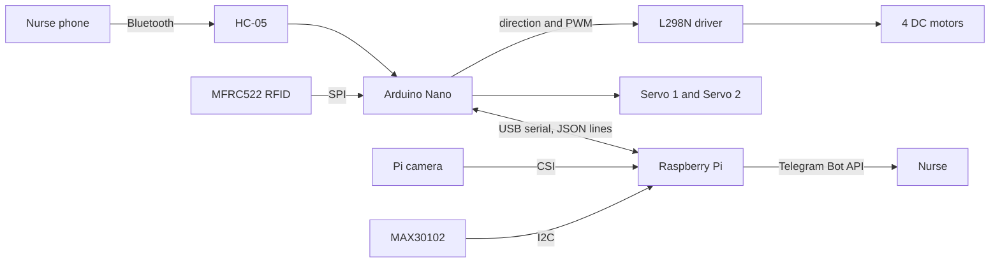

# MedCart: Automated Medication Dispensing and Vitals Monitoring Cart

MedCart is a mobile cart that carries medication to a patient's bed, confirms it is at the correct bed, identifies the patient by RFID, dispenses the prescribed dose from a servo-driven compartment, measures heart rate and SpO₂, and reports the result to a nurse on Telegram.

It was built as a final year project for the BTech in Mechatronics and Systems Engineering at Abubakar Tafawa Balewa University (ATBU), Bauchi.

> **Status:** working prototype. MedCart is a research and teaching project. It is **not** a certified medical device and must not be used for real patient care.


## Features

- **Manual navigation** by Bluetooth: forward, backward, left, right, stop and speed control from a phone.
- **Bed verification** with ArUco markers read by a Raspberry Pi camera and OpenCV.
- **Patient identification** with an MFRC522 RFID reader and wristband tags.
- **Safety interlock:** a dose is dispensed only when the detected bed matches the bed assigned to the identified patient.
- **Two-slot dispenser** driven by two servo motors.
- **Vitals monitoring** with a MAX30102 sensor, with alert limits for heart rate and SpO₂.
- **Nurse interface** on Telegram for notifications, reports and manual dispense requests.
- **Local database** (SQLite) that logs patients, dispensing events and vitals.
- **Modular software:** independent Python nodes that communicate over MQTT, so one node can fail or be replaced without rebuilding the rest.

## System architecture



The **Arduino Nano** handles real-time tasks: motor control, RFID reading, Bluetooth command parsing and servo positioning. The **Raspberry Pi** runs the coordination logic, database, computer vision, vitals acquisition and the Telegram bot.

## Hardware

| Component | Qty | Role |
|---|---|---|
| Raspberry Pi 3 | 1 | High-level computer, MQTT broker, vision, vitals, Telegram |
| Arduino Nano | 1 | Low-level controller |
| HC-05 Bluetooth module | 1 | Wireless navigation commands |
| MFRC522 (RC522) RFID reader | 1 | Patient identification |
| MAX30102 sensor | 1 | Heart rate and SpO₂ |
| Raspberry Pi camera module | 1 | ArUco bed marker detection |
| L298N motor driver | 1 | Drives the four chassis motors |
| DC gear motors | 4 | Chassis propulsion |
| Servo motors | 2 | Dispensing slots 1 and 2 |
| 3S Li-ion pack with 3S 20 A BMS | 1 | Main power for motors and logic |
| Power bank, 5 V 2 A | 1 | Dedicated supply for the Raspberry Pi |

### Arduino Nano pin map

| Pin | Connected to | Function |
|---|---|---|
| D13 | RC522 SCK | SPI clock |
| D12 | RC522 MISO | SPI data in |
| D11 | RC522 MOSI | SPI data out |
| D10 | RC522 SDA (SS) | SPI slave select |
| A1 | RC522 RST | Reader reset |
| D2, D3 | L298N IN1, IN2 | Left motors direction |
| D4, D5 | L298N IN3, IN4 | Right motors direction |
| D6 | L298N ENA | Left motors speed (PWM) |
| D7 | L298N ENB | Right motors enable |
| D8 | HC-05 TX | SoftwareSerial RX |
| D9 | HC-05 RX | SoftwareSerial TX, through a voltage divider |
| A0 | Servo 1 signal | Dispensing slot 1 |
| A2 | Servo 2 signal | Dispensing slot 2 |

The MAX30102 connects directly to the Raspberry Pi over I2C (3.3 V, GND, SDA on GPIO2, SCL on GPIO3, address `0x57`). The RC522 runs from 3.3 V only. The HC-05 RX pin needs a 5 V to 3.3 V divider on the Nano TX line.

## Repository structure

> Adjust this section to match your folders.

```
medcart/
├── arduino/           # Arduino Nano firmware (main.cpp)
├── nodes/               # Python nodes (coordinator, RFID, CV, vitals, dispenser, Telegram)
├── core/                # Shared modules (database, patient service)
├── docs/                # Report, diagrams and images
├── .env.example         # Example configuration (copy to .env)
├── requirements.txt     # Python dependencies
└── README.md
```

## Getting started

### Prerequisites

- Raspberry Pi running Ubuntu, with Python 3.10 or newer
- Mosquitto MQTT broker
- Arduino IDE or PlatformIO for the Nano firmware
- A Telegram bot token from [@BotFather](https://t.me/BotFather)

### 1. Clone the repository

```bash
git clone https://github.com/samuel-shaibu/medcart.git
cd <medcart>
```

### 2. Install the broker and Python packages (on the Pi)

```bash
sudo apt update
sudo apt install -y mosquitto mosquitto-clients python3-venv i2c-tools
sudo systemctl enable --now mosquitto

python3 -m venv .venv
source .venv/bin/activate
pip install -r requirements.txt
```

Enable I2C for the MAX30102 and the camera interface for the Pi camera in the Pi configuration.

### 3. Configure

```bash
cp .env.example .env
nano .env
```

```ini
MQTT_BROKER=localhost
MQTT_PORT=1883
TELEGRAM_BOT_TOKEN=<your-token>
```

Never commit `.env`. It holds your bot token.

### 4. Flash the Nano

With PlatformIO (library: `miguelbalboa/MFRC522`):

```bash
cd arduino/rfid_reader
pio run -t upload
```

Or open the sketch in the Arduino IDE, install the **MFRC522** library, select **Arduino Nano**, and upload.

### 5. Run the nodes

Start the broker first, then each node in its own terminal, `tmux` pane or `systemd` service:

```bash
python3 nodes/coordinator_node.py
python3 nodes/<other_node>.py
```

To watch all traffic while testing:

```bash
mosquitto_sub -t "medcart/#" -v
```

## Usage

### Bluetooth commands

Send a single character from any Bluetooth serial app. Upper and lower case are equivalent.

| Command | Action |
|---|---|
| `F` / `f` | Forward |
| `B` / `b` | Backward |
| `L` / `l` | Turn left |
| `R` / `r` | Turn right |
| `S` / `s` | Stop |
| `0` to `9`, `q` | Set speed (`q` is maximum) |

### Medication round

1. Drive the cart to the bed.
2. The camera detects the bed's ArUco marker and the CV node publishes the bed number.
3. The patient scans an RFID wristband. The coordinator loads the patient record.
4. If the patient's assigned bed equals the detected bed, the coordinator sends a dispense command for the patient's slot. If not, dispensing is withheld.
5. A short time after dispensing, the vitals node reads heart rate and SpO₂.
6. The reading is stored, compared with the alert limits, and reported to the nurse on Telegram.

## Communication interfaces

### Serial protocol (Nano and Raspberry Pi, 9600 baud, one JSON object per line)

| Direction | Example |
|---|---|
| Nano to Pi | `{"type":"rfid","uid":"A1B2C3D4","status":"ok"}` |
| Nano to Pi | `{"type":"move","cmd":"F","speed":180}` |
| Nano to Pi | `{"type":"dispense","slot":1,"status":"ok"}` |
| Pi to Nano | `{"cmd":"dispense","slot":1}` |

### MQTT topics used by the coordinator

| Topic | Direction | Content |
|---|---|---|
| `medcart/rfid/scan` | Subscribe | Tag UID from the Nano |
| `medcart/cv/bed_detected` | Subscribe | Bed number from ArUco detection |
| `medcart/dispense/request` | Subscribe | Manual dispense request from Telegram |
| `medcart/dispense/status` | Subscribe | Result of a dispensing cycle |
| `medcart/vitals/reading` | Subscribe | Heart rate and SpO₂ |
| `medcart/patient/identified` | Publish | Patient record for the nurse |
| `medcart/dispense/execute` | Publish | Slot and patient for the dispenser |
| `medcart/vitals/trigger` | Publish | Start a vitals reading |
| `medcart/vitals/alert` | Publish | Reading outside limits |
| `medcart/notify/telegram` | Publish | Message for the nurse |

### Vitals alert limits

| Measurement | Lower | Upper |
|---|---|---|
| Heart rate | 50 bpm | 110 bpm |
| SpO₂ | 94 % | 100 % |

## Test results summary

| Test | Result |
|---|---|
| Motor control | All movement and stop commands worked |
| RFID | 4 of 4 cards classified correctly (2 registered, 2 unregistered) |
| Dispensing | Both slots dispensed as expected |
| Bed verification | Correct bed detected; a bed-patient mismatch was blocked |
| Battery endurance | 2 h 30 min measured against a 2.67 h estimate |
| Integration | Full medication round completed and Telegram report received |
| Vitals accuracy | Not yet validated against a reference pulse oximeter |

The full methodology, circuit diagrams and results are in the project report in `docs/`.

## Known limitations

- The firmware does not stop the motors automatically when the Bluetooth link is lost.
- A dispensing cycle blocks the Nano main loop while the servo is open.
- The right-hand motor enable is on pin D7, which is not a PWM pin on the Nano, so right-side speed is effectively on or off.
- Scanning the same wristband again can trigger a second dispense, because there is no check that the dose was already given.
- On the automatic path a bed mismatch withholds the dose without a message to the nurse.
- MAX30102 readings are indicative only and have not been clinically validated.

## Roadmap

- [ ] Automatic stop on loss of Bluetooth signal
- [ ] Dose-already-given check
- [ ] Nurse alert on bed mismatch
- [ ] Validate vitals against a reference pulse oximeter
- [ ] Replace jumper wiring with a printed circuit board
- [ ] Autonomous navigation to the bed

## Contributing

Issues and pull requests are welcome. Please open an issue first to discuss major changes.

## License

Released under the MIT License. See [LICENSE](LICENSE).

## Author

**Samuel** ([@samuel-shaibu](https://github.com/samuel-shaibu))
Department of Mechatronics and Systems Engineering, Abubakar Tafawa Balewa University, Bauchi.

Project team and supervisor: *Team: medic* *Engr. Aliyu Sambo*

## Acknowledgements

Thanks to the supervisor and the department for guidance, and to the open-source communities behind Mosquitto, OpenCV, Picamera2 and the MFRC522 library.
